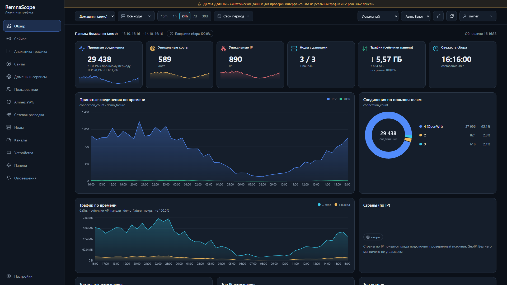
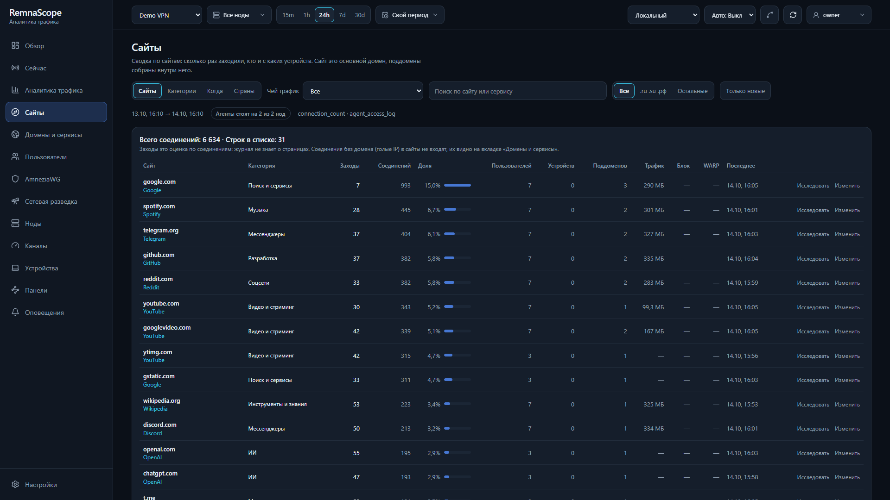
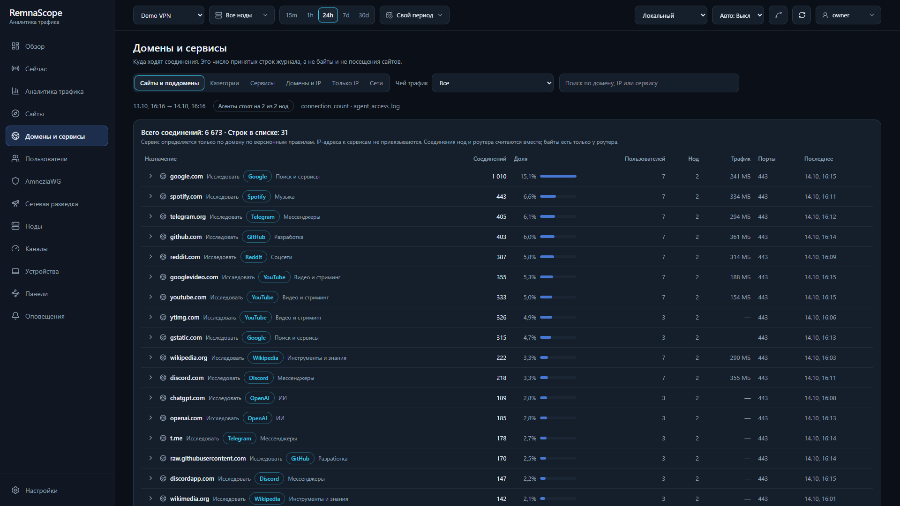
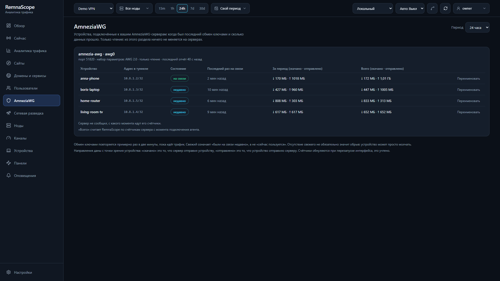
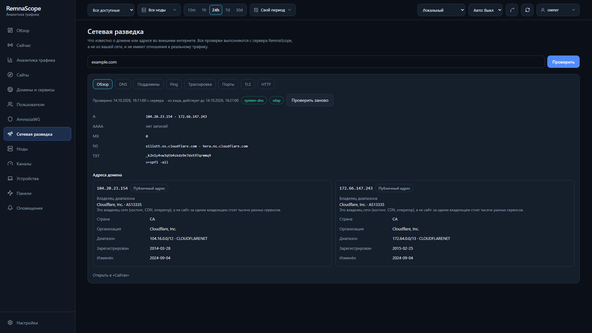

# RemnaScope

Self-hosted traffic analytics for [Remnawave](https://github.com/remnawave) / Xray: one dashboard over several
independent panels and their nodes, with honest attribution of what is measured and what is not.

> The interface is in **Russian** (all strings live in `apps/web/src/i18n`, so adding a language is a matter of
> translating those files). Documentation is in English unless a file says otherwise. A short Russian guide is in
> [README.ru.md](README.ru.md).

## What it does

- **Several panels at once.** Each Remnawave panel keeps its own credentials, nodes, users and retention. Views are
  isolated per panel; panel API tokens are encrypted at rest (AES-256-GCM, versioned keys, rotation).
- **Traffic from the nodes.** A small read-only agent follows the Xray access log of a node and ships it over an
  outbound WebSocket, with a bounded disk spool and exact reporting of anything dropped.
- **Sites, domains and services.** Connections are grouped by site, service and category (rule based, with an
  optional, off-by-default AI assistant that proposes categories for unknown sites).
- **Devices behind a router.** A router agent (sing-box Clash API + DHCP leases, e.g. OpenWrt) names the devices
  behind a shared VPN account and counts their bytes.
- **AmneziaWG servers.** Read-only collector (devices, handshakes, totals), optional device management (add, revoke,
  rename, with QR configs) and an optional traffic sensor that adds AmneziaWG traffic to the same site/domain lists.
- **Network intelligence.** Look up an IP, domain or ASN; geo/ASN data is bundled (DB-IP Lite).
- **DNS Map.** The publicly observable DNS records of a domain, how they link, and what changed: two resolvers must
  agree before a change is recorded, authoritative servers are compared, and DNSSEC is reported as not checked. It
  shows the names it knows, never "the whole zone".
- **Server security.** A VPS is the unit: a read-only agent reports Fail2ban, listening sockets and firewall rules; the
  server checks known public ports and TLS certificates from outside (and says that point of view is not
  independent); a journal, alerts and 180-day retention; and the owner can ban or unban one address through a narrow
  helper, with confirmation and an audit trail.
- **Everyday tools.** Live view, alerts, endpoint probes, activity heat map, per-country view, CSV-free API.
- **Security by default.** Argon2id accounts with roles and optional TOTP, rate limits and lockout, CSRF, strict
  security headers, SSRF-guarded outbound requests, no secrets in environment variables.

What it deliberately does **not** do: invent numbers. Bytes come only from panel counters, the router or the AmneziaWG
sensor, and each figure says where it came from. If a source is not connected, the UI says "no data", not zero.



Screenshots come from the dev stack with invented data (`cmd/demodata`).

| | |
|---|---|
|  **Sites** |  **Domains and services** |
|  **AmneziaWG** |  **Network intelligence** |

Also: [nodes](docs/screenshots/nodes.png), [panels](docs/screenshots/panels.png).

## Quick start (production)

You need a Linux server with Docker, a DNS name pointing at it, and ports 80/443 free (Caddy gets the certificate).

```bash
git clone https://github.com/Taminum/RemnaScope.git && cd RemnaScope/deploy/prod
sudo ./init-secrets.sh scope.example.com v0.2.0     # host name, release tag; creates secrets and .env, prints nothing
sudo docker compose -f compose.prod.yml up -d       # pulls ghcr.io/taminum/remnascope-{api,web}
sudo cat secrets/owner_password                     # sign in at https://scope.example.com as "owner"
```

Then add a panel in the UI, create an agent for a node, and install it as described in
[docs/AGENT.md](docs/AGENT.md). Full guide, backups, updates and rollback: [docs/INSTALL.md](docs/INSTALL.md).

Back up `secrets/master_key` somewhere other than the server: without it the stored panel tokens cannot be decrypted.

## Try it locally (demo data, mock panels)

```bash
./deploy/init-dev-secrets.sh        # or .ps1 on Windows; writes ./secrets once, prints nothing
docker compose up -d --build        # http://localhost:8088, bound to 127.0.0.1 only
```

Sign in as `owner` with the password from `secrets/owner_password`. The dev stack includes two mock Remnawave panels
(`mock-home.demo.test:8443`, `mock-work.demo.test:8444`, tokens in `secrets/mock_*_token`; tick "trust the admin CA")
so you can walk through the connection wizard without a real panel. Mock panels and `SEED_DEMO` are for development
only and are not part of the release images.

## Components

| Part | Where | Notes |
|---|---|---|
| API + workers | `cmd/api`, `internal/` | Go, PostgreSQL, migrations embedded and applied on start |
| Web UI | `apps/web` | React, TypeScript, Tailwind, served by nginx behind Caddy |
| Node agent | `cmd/agent` | read-only; also router and AmneziaWG modes |
| AmneziaWG sensor | `cmd/awgsensor` | optional, passive packet parser, drops privileges |
| Security agent | `cmd/secagent` | read-only; also the Fail2ban helper (`secagent helper`), see [docs/SECURITY_AGENT.md](docs/SECURITY_AGENT.md) |
| Deploy files | `deploy/` | prod compose + Caddy, systemd units, router init script, AWG helpers |

Release binaries (agent, sensor) and checksums are attached to each [GitHub release](../../releases).

## Development

```bash
go vet ./cmd/... ./internal/... && go test ./cmd/... ./internal/...      # database tests need TEST_DATABASE_URL (see below)
cd apps/web && npm ci && npm run lint && npm test && npm run build
```

Database tests need an admin connection to any Postgres, e.g. `TEST_DATABASE_URL=postgres://postgres:pw@127.0.0.1:55432/postgres`;
each test gets its own database and they are skipped without it. Run Go tests as `./cmd/... ./internal/...`, not
`./...`, because a local `apps/web/node_modules` can contain stray Go files.

To fill the analyzer pages with invented traffic (a dev database only, never a real one): `go run ./cmd/demodata -dev-database` with `DATABASE_URL` set; then `node apps/web/scripts/readme-shots.mjs` retakes the screenshots.

Without Docker: a Postgres, `go run ./cmd/api` (needs `DATABASE_URL`, `MASTER_KEY_FILE`) and
`cd apps/web && npm run dev` (http://localhost:5173, `/api` proxied to :8080).

## Documentation

- [INSTALL](docs/INSTALL.md): production install, updates, backups, rollback
- [AGENT](docs/AGENT.md): installing the node agent (what it can and cannot do)
- [OPERATIONS](docs/OPERATIONS.md): secrets, key rotation, accounts, rate limits, production checklist
- [SECURITY](docs/SECURITY.md), [ARCHITECTURE](docs/ARCHITECTURE.md), [INGESTION](docs/INGESTION.md),
  [API_SPEC](docs/API_SPEC.md), [DATA_MODEL](docs/DATA_MODEL.md)
- [SECURITY_AGENT](docs/SECURITY_AGENT.md), [SECURITY_CHECKS](docs/SECURITY_CHECKS.md), [DNS_MAP](docs/DNS_MAP.md)
- [AWG_COLLECTOR](docs/AWG_COLLECTOR.md) (AmneziaWG, Russian), [AUTOCLASSIFY](docs/AUTOCLASSIFY.md) (AI categories, Russian)

## License

[AGPL-3.0](LICENSE): free to use, change and share, including commercially; if you modify it or run a modified version as a network service, you must publish your source under the same license. The bundled GeoIP and ASN data are the free DB-IP Lite databases, licensed
[CC BY 4.0](https://creativecommons.org/licenses/by/4.0/); attribution: IP geolocation by [DB-IP](https://db-ip.com).
